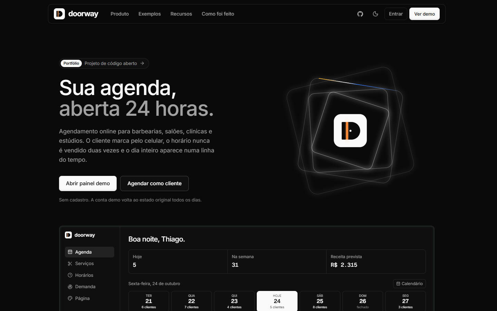
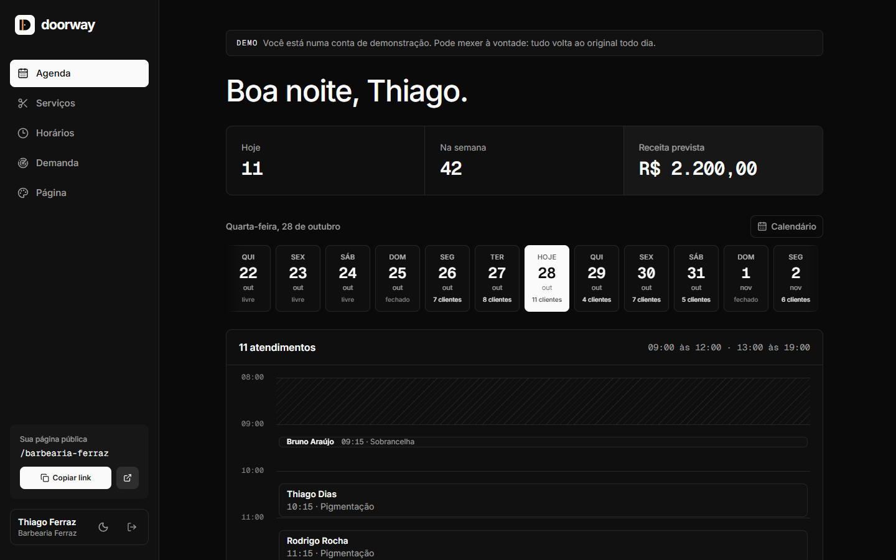
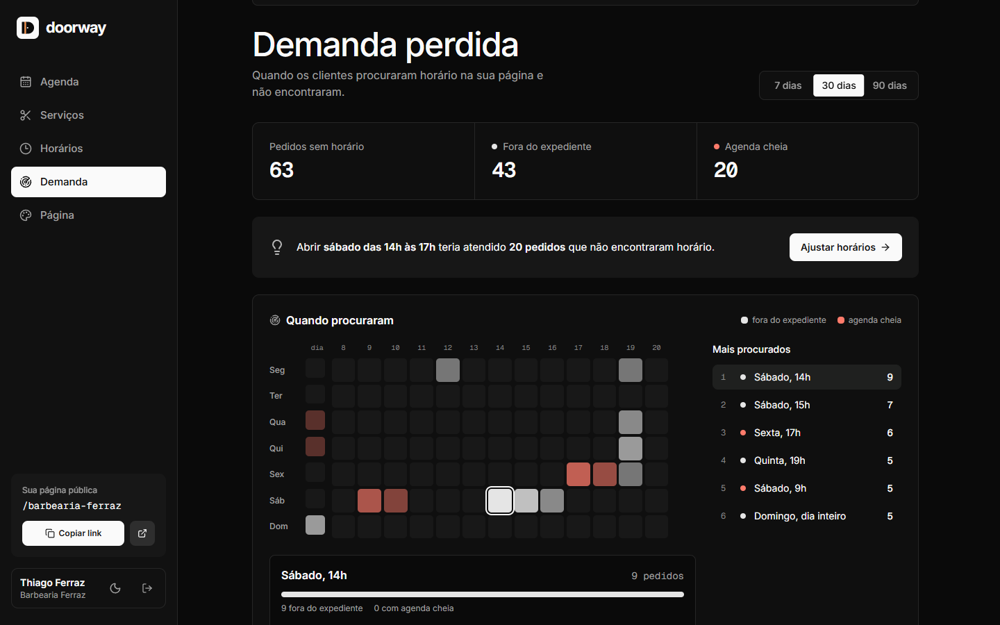
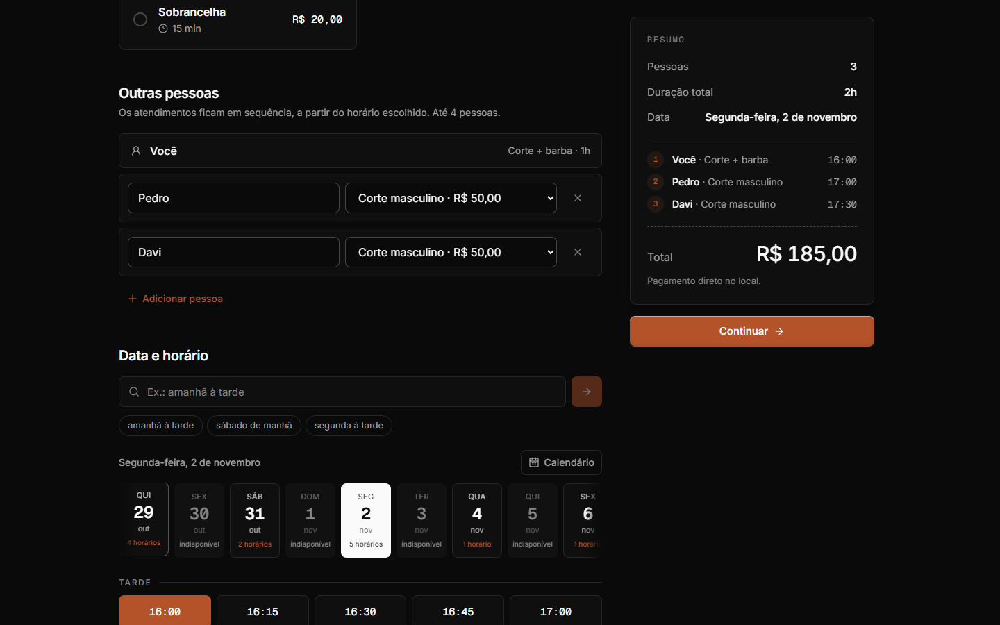
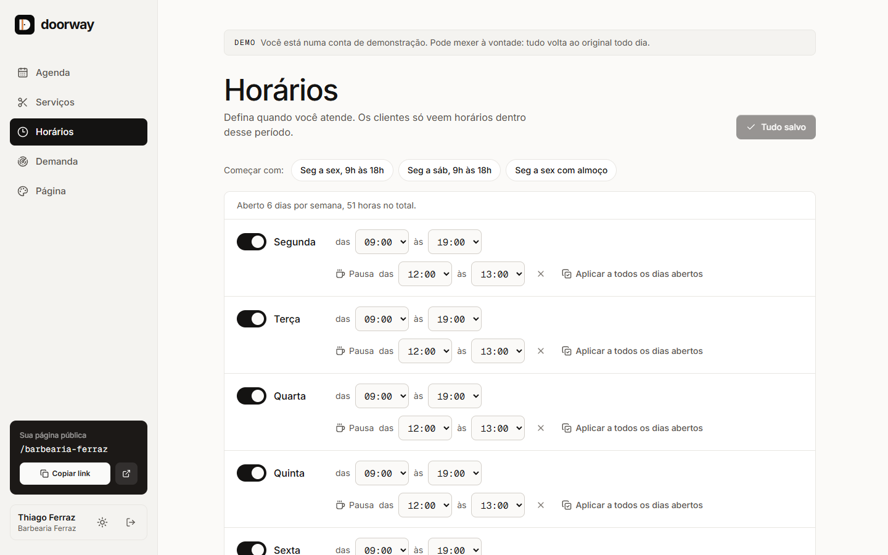
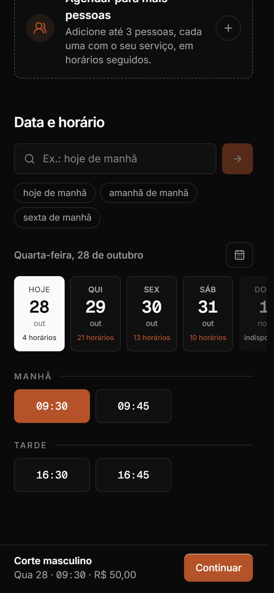
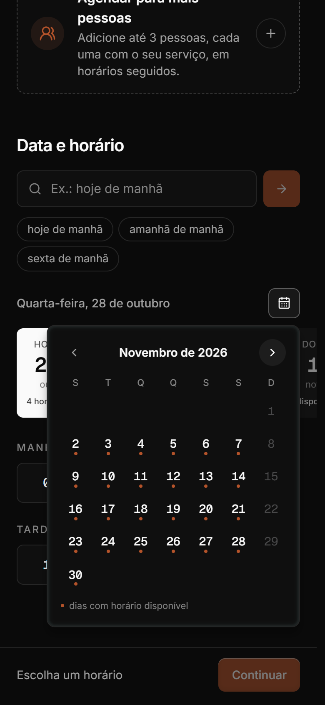
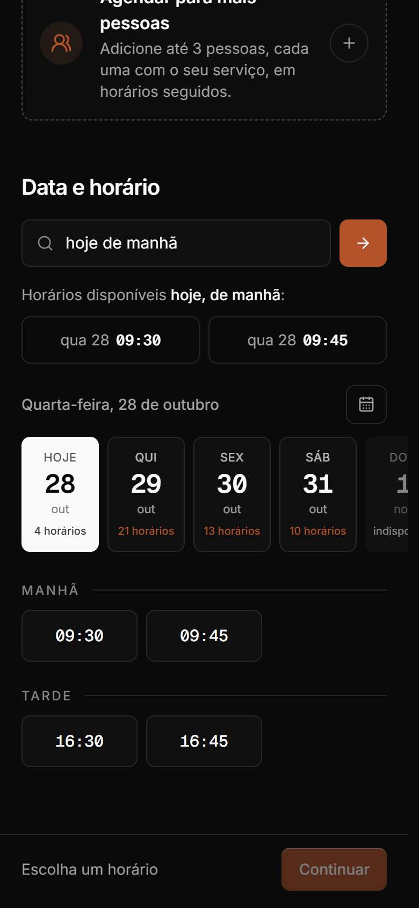
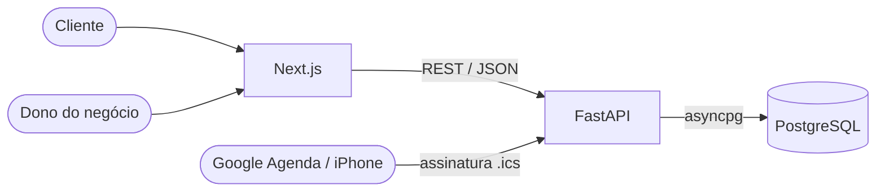

<p align="center">
  
</p>

<h1 align="center">Doorway</h1>

<p align="center">
  Agendamento online para pequenos negócios, com reservas que não entram em conflito sob concorrência.
</p>

<p align="center">
  <a href="https://doorway-six.vercel.app">Demonstração</a> ·
  <a href="https://doorway-six.vercel.app/como-foi-feito">Como foi feito</a> ·
  <a href="https://doorway-api-jet.vercel.app/docs">Documentação da API</a>
</p>

<p align="center">
  <a href="https://github.com/noitsuka/doorway/actions/workflows/backend.yml"></a>
  <a href="https://github.com/noitsuka/doorway/actions/workflows/frontend.yml"></a>
</p>



## Visão geral

Cada negócio tem uma página pública onde o cliente escolhe serviço, data e horário, sozinho ou com outras pessoas. O dono acompanha a agenda num painel que se atualiza sozinho e vê também quando os clientes procuraram horário e não encontraram. A disponibilidade é calculada a cada consulta, e o banco garante que dois clientes nunca fiquem com o mesmo horário.

**Para testar:** o botão **Ver demo** abre o painel de uma barbearia de exemplo, sem cadastro. A página do cliente dessa barbearia fica em [`/barbearia-ferraz`](https://doorway-six.vercel.app/barbearia-ferraz). Os dados da demo são recriados todo dia às 03:00 (horário de Brasília).

## Telas

| Agenda do dono | Demanda perdida |
| --- | --- |
|  |  |
| **Reserva em grupo** | **Horários, no tema claro** |
|  |  |

| Página de reserva | Calendário | Busca por frase |
| --- | --- | --- |
|  |  |  |

## Funcionalidades

**Para quem agenda**

- Escolha da data numa faixa de dias ou num calendário, com a quantidade de horários livres em cada dia
- Busca por frase, como "sexta à tarde" ou "amanhã depois das 18h", com sugestões montadas a partir dos horários disponíveis
- Reserva para até quatro pessoas em horários seguidos, cada uma com o seu serviço: ou todos os horários são reservados, ou nenhum
- Próximos horários sugeridos quando o escolhido acaba de ser reservado por outra pessoa
- Contato por WhatsApp ou telefone, com e-mail opcional
- Remarcação e cancelamento por um link próprio, sem criar conta
- Evento no Google Agenda ou no Outlook e arquivo `.ics`

**Para o dono do negócio**

- Agenda numa faixa de dias que se arrasta ou num calendário, com a quantidade de clientes por dia e a receita prevista da semana, atualizada automaticamente
- Serviços com duração e preço, com prévia de como aparecem na página
- Horários com modelos prontos, pausa para o almoço e opção de aplicar a todos os dias
- Relatório de demanda perdida por dia e hora, com sugestão de qual horário abrir
- Bloqueio de clientes por telefone e e-mail, direto da agenda
- Página com nome, categoria, cor e foto próprios
- Feed `.ics` de assinatura para ver os agendamentos no celular

**Por baixo**

- Reservas sem conflito mesmo com pedidos simultâneos
- Proteção contra reservas falsas sem captcha
- Tema claro e escuro, interface pensada primeiro para o celular

## Stack

| Camada | Tecnologias |
| --- | --- |
| Backend | Python 3.14, FastAPI, SQLAlchemy 2 (async), asyncpg, Pydantic 2, Alembic |
| Banco | PostgreSQL 17 (restrição de exclusão com `btree_gist`) |
| Frontend | Next.js 16, React 19, TypeScript, Tailwind CSS 4, Motion, GSAP |
| Qualidade | pytest, Hypothesis, Ruff, ESLint, Prettier, GitHub Actions |
| Infra | Docker, Gunicorn + Uvicorn, Vercel, Neon |

## Arquitetura



```
backend/app/
  reservas.py              reservas simples e em grupo: trava por negócio, conferência e limites
  disponibilidade.py       cálculo de horários livres (funções puras, sem I/O)
  frases.py                interpretador da busca por frase e frases sugeridas
  demanda.py               registro e relatório da demanda perdida
  antifraude.py            token do formulário, e-mails temporários, limite por conexão, bloqueios
  painel_publico.py        contato mascarado no painel aberto da demo
  rotas/                   autenticação, negócio, serviços, horários, agendamentos, página pública,
                           gestão, calendário, demanda, bloqueios, demo
  middleware.py            id por requisição, headers de segurança, limite de tamanho do corpo
  limite_requisicoes.py    limites de tentativas compartilhados entre workers
frontend/src/
  app/             início, como foi feito, página de reserva, gestão do agendamento e painel
                   (agenda, serviços, horários, demanda, página)
  components/      interface, reserva (datas, calendário, horários, grupo) e seções do início
  lib/             cliente da API, tipos, formatação de datas e moeda, validação
docs/adr/          registro das decisões de arquitetura
```

## Decisões técnicas

As decisões estão registradas em [`docs/adr`](docs/adr). Resumo:

**Reservas concorrentes** ([ADR 0001](docs/adr/0001-reservas-sem-conflito.md)). A reserva trava a linha do negócio com `SELECT ... FOR UPDATE`, confere o horário e grava na mesma transação. Uma restrição de exclusão impede sobreposição mesmo que algum caminho do código esqueça a trava:

```sql
EXCLUDE USING gist (negocio_id WITH =, tstzrange(inicio, fim) WITH &&)
WHERE (status <> 'cancelado')
```

Sem a trava, os testes de concorrência mostraram deadlock entre inserções sobrepostas. O custo é serializar as reservas de um mesmo negócio; negócios diferentes continuam em paralelo.

**Disponibilidade calculada** ([ADR 0002](docs/adr/0002-horarios-calculados.md)). Não existe tabela de horários vagos. O expediente é convertido para UTC e os intervalos ocupados são percorridos uma única vez. Um teste baseado em propriedades compara o resultado com uma implementação de força bruta, e outro cobre a mudança de horário de verão.

**Limite de tentativas no PostgreSQL** ([ADR 0003](docs/adr/0003-limites-no-postgres.md)). Contadores por janela fixa com `INSERT ... ON CONFLICT`, compartilhados entre workers e instâncias serverless, sem depender de Redis.

**Calendário sem OAuth** ([ADR 0004](docs/adr/0004-calendario-sem-oauth.md)). Link de template e `.ics` para o cliente, e feed de assinatura com token secreto para o dono. Nenhum app precisa de aprovação do Google.

**Foto do negócio no banco** ([ADR 0005](docs/adr/0005-foto-no-banco.md)). A imagem é recortada e reduzida para 256 px no navegador, validada pelos bytes no servidor e servida com cache permanente por URL versionada.

**Busca por frase com regras** ([ADR 0006](docs/adr/0006-busca-por-frase.md)). Um interpretador por regras converte a frase em dias e faixa de horário, e os horários vêm do mesmo cálculo da grade. As sugestões exibidas na página só incluem frases que têm horário livre.

**Demanda perdida** ([ADR 0007](docs/adr/0007-demanda-perdida.md)). Dias sem horário livre e buscas sem resultado viram registros classificados em fora do expediente ou agenda cheia. O visitante é um HMAC do IP com a data, e uma restrição única com `NULLS NOT DISTINCT` evita contar a mesma pessoa duas vezes.

**Reserva em grupo** ([ADR 0008](docs/adr/0008-reserva-em-grupo.md)). O grupo é validado como um único bloco com a soma das durações, sob a mesma trava por negócio, e gravado numa só transação. Qualquer conflito desfaz o grupo inteiro.

**Proteção contra reservas falsas** ([ADR 0009](docs/adr/0009-antifraude.md)). A página pública entrega um token HMAC com o horário de carregamento, e a reserva só é aceita depois de 3 segundos e antes de 6 horas. Também são conferidos um campo armadilha, e-mails temporários e o limite de reservas futuras por conexão. O telefone identifica o cliente, e o dono pode bloquear telefone e e-mail a partir da agenda.

## Segurança

| Cenário | Resposta |
| --- | --- |
| Reservas simultâneas para o mesmo horário | uma `201`, as demais `409` |
| Byte nulo, surrogates ou números fora de faixa na entrada | `422`, sem ecoar o valor enviado |
| Corpo acima de 64 KB | `413` antes de ler o restante |
| Força bruta no login, enxurrada de reservas | `429` com `Retry-After` |
| `X-Forwarded-For` forjado | ignorado, a menos que venha do proxy configurado |
| Upload de SVG ou arquivo renomeado como imagem | `422`, o tipo é detectado pelos bytes |
| Um mesmo telefone reservando todos os horários | limite de 3 reservas futuras por negócio |
| Robô enviando o formulário de reserva | `400`: token assinado com tempo mínimo de 3 s e campo armadilha |
| E-mail temporário ou muitas reservas da mesma conexão | `422` e `409`, com limite de 6 reservas futuras por conexão |
| Cliente bloqueado pelo dono | `403`, por telefone ou e-mail |
| Visitante que reserva na demo com dados reais | contato mascarado no painel demo, que é aberto |
| Imagem enviada pela conta demo para a página pública | `403`, a foto da demo é fixa |

Senhas com Argon2, login com tempo constante (não revela quais e-mails existem) e tokens de 43 caracteres nos links de gestão e de calendário. Em produção, o site envia uma Content-Security-Policy que só aceita código da própria origem e conexões com a API.

## Testes

```bash
cd backend
pip install -e ".[dev]"
pytest
```

227 testes: unidade, API, propriedades, fuzzing e um teste de caos com 60 clientes simultâneos que, ao final, confere no banco que nenhuma regra foi violada. Em SQLite, os 11 testes que dependem do PostgreSQL são pulados. Com `DATABASE_URL` apontando para PostgreSQL rodam todos, como na CI, que também executa `alembic check`. No frontend, a CI confere tipos, ESLint, Prettier e o build.

O desempenho pode ser medido com `backend/scripts/teste_carga.py`. Numa máquina local, com 4 workers e 50 conexões, a consulta de horários sustentou cerca de 1.600 req/s com p99 de 42 ms. A demonstração roda em funções serverless, então a latência lá é dominada pela rede.

## Executando localmente

Requisitos: Docker e Node.js 24.

```bash
docker compose up --build
docker compose exec api python -m app.dados_demo
cd frontend && cp .env.example .env.local && npm install && npm run dev
```

API em `http://localhost:8000` (documentação em `/docs`), site em `http://localhost:3000`.

## Deploy

Frontend e API são dois projetos na Vercel, com as funções em São Paulo (`gru1`). O banco é um PostgreSQL no Neon na mesma região, conectado pela integração da Vercel.

| Variável | Onde | Descrição |
| --- | --- | --- |
| `DATABASE_URL_UNPOOLED` | API | conexão direta ao PostgreSQL (preenchida pela integração) |
| `JWT_SECRET` | API | segredo dos tokens e das assinaturas HMAC, mínimo de 32 caracteres |
| `CORS_ORIGINS` | API | lista JSON com a origem do frontend |
| `DB_NULL_POOL` | API | `true` em ambiente serverless |
| `TRUST_REAL_IP_HEADER` | API | `true` atrás do proxy da Vercel |
| `CRON_SECRET` | API | protege o reset diário da demo |
| `MIN_FORM_SECONDS` | API | opcional, tempo mínimo de preenchimento da reserva (padrão 3) |
| `MAX_UPCOMING_BOOKINGS_PER_IP` | API | opcional, reservas futuras por conexão em cada negócio (padrão 6) |
| `NEXT_PUBLIC_API_URL` | Frontend | URL pública da API |

Migrações: `alembic upgrade head` com `DATABASE_URL` apontando para o banco de produção.

## Limitações e próximos passos

- Um profissional por negócio. O próximo passo é a agenda por profissional, com a opção "qualquer um".
- Sem e-mails de confirmação e lembrete. O desenho previsto é uma fila com tentativas e chave de idempotência.
- O painel se atualiza por consulta periódica. Com mais volume, SSE.
- Sem bloqueio manual de horários pelo dono.
- A lista de domínios de e-mail temporário é fixa e cobre os serviços mais usados.

## Licença

[MIT](LICENSE)
